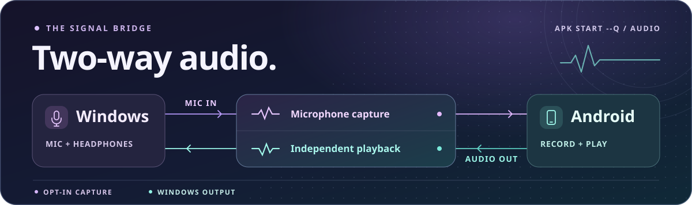

<p align="center">
  
</p>

<h1 align="center">Apk Start --Q 1.0.2</h1>

<p align="center"><strong>让 Android 应用从 Windows 桌面直接打开。</strong></p>
<p align="center">
  <a href="#改进项目">改进项目</a> ·
  <a href="#快速开始">快速开始</a> ·
  <a href="#功能与边界">功能与边界</a> ·
  <a href="#构建和测试">构建和测试</a> ·
  <a href="#反馈与许可">反馈与许可</a>
</p>

**Apk Start --Q** 是一个面向 **Windows 10 / 11 x64** 的 Android 应用运行器。导入安装包后，可以为应用建立桌面与开始菜单入口。程序按需管理 Android 运行时，不必先打开另一款模拟器。

## 改进项目

### Windows 与 Android 双向音频



**你在 Windows 这头说话，安卓应用从那头收声。** Windows 默认麦克风负责录音输入，安卓应用的声音则经 Windows 默认输出回到耳机或扬声器。两条路各有开关：不开麦克风，也能照常听声音。

[`audio-policy.js`](src/core/audio-policy.js) 将录音和播放分别映射为 AVD 的 `hw.audioInput` 与 `hw.audioOutput`，仅在 Windows 上显式开启麦克风后才向 Android Emulator 传入 `-allow-host-audio`。音频策略也纳入 Quick Boot 快照的兼容性判定：设置不匹配时跳过旧快照，保留已装应用和数据。

想试录音？先在 Windows「设置 → 系统 → 声音」选好默认麦克风和耳机，再到 Apk Start --Q「设置 → 性能与资源」打开 **Windows 麦克风输入**，重启安卓运行时，最后按需给安卓应用录音权限。

麦克风默认关闭；这是音频转发，不是 USB 设备直通。开关、启动参数和快照策略已有自动化测试，真实麦克风、耳机与全民 K 歌录音仍待实机验证。详见 [Windows 音频说明](docs/rewrite-phase-2.md)。

### 代码层面的改进

- **运行时串行调度，会话独立管理。** [`RuntimeLifecycle`](src/application/runtime-lifecycle.js) 将启动、停机、换向和维护排进同一条队列，只合并未被停机、换向或维护隔开的同类启动请求。物理换向须确认停机后才写面板配置；[`AppSessions`](src/application/app-sessions.js) 用窗口令牌隔离旧窗口的迟到回调，避免误关新窗口。
- **ADB 命令统一路由，按实例核验归属。** [`AdbClient`](src/core/adb.js) 收口 ADB 程序、服务端口和命令传输，区分服务端操作与指定设备的命令；[运行时归属校验](src/core/runtime-ownership.js) 交叉核对 AVD 锁、监听端口所属 PID 和模拟器控制台报告的 AVD 名称，不按端口猜测归属。
- **拆分包采用流式暂存。** [`parseBundle`](src/core/installer.js) 按 ZIP 条目的声明体积预检磁盘，把 `.apks` / `.xapk` 的分片流式写入独立临时目录，再按实际写入量复查容量。读取元数据时优先选 `base.apk`，不改动分片安装顺序；ABI（CPU 架构）兼容性重试复用这批分片，操作结束后清理暂存目录。
- **IPC 单点注册，保留现有接口。** [`dispatch.js`](src/ipc/dispatch.js) 在向 Electron 注册前检查重复通道；处理器按业务拆分，保留现有 preload 通道名与返回结构。[异常日志](src/ipc/failure.js) 记录通道、分类和可用的项目内位置，不写请求参数或底层命令输出。设置导航、运行时、诊断等界面逻辑也拆成了[独立模块](src/ui/panels)。
- **残留扫描移出主进程的同步路径。** [`leftovers.js`](src/core/leftovers.js) 异步查询注册表，分批并行获取文件信息；把只读预览和确认后的删除操作分开，避免磁盘盘点期间主进程同步等待。

## 快速开始


1. **从源码启动。** 在 Windows 上准备 Git 和 Node.js 20 或更新版本，然后运行：

   ```powershell
   git clone https://github.com/MoonlyCake/apkstart.git
   cd apkstart
   npm ci
   npm start
   ```

2. **准备运行时。** 首次打开时，按程序提示部署 Android Emulator、ADB 和系统镜像。初次部署需要联网下载组件，并为镜像、应用数据和快照留出磁盘空间。
3. **安装并打开。** 从界面选择 `.apk`、`.apks` 或 `.xapk`；也可以先开启 `.apk` 文件关联，再从资源管理器双击安装。安装完成后，可以从应用列表或已创建的快捷方式打开。

## 功能与边界


| 功能 | 使用时要知道 |
| --- | --- |
| **独立窗口与快捷方式** | 支持原生窗口与嵌入窗口，默认使用原生窗口。可在工具栏、托盘或设置里调整显示方式；物理面板换向可能需要重启安卓运行时。 |
| **安装普通与拆分 APK** | `.apks` 和 `.xapk` 中包含的 APK 分片可一并安装。能否运行取决于应用要求的 Android 版本、原生库架构和所用镜像。 |
| **Windows 麦克风与声音输出** | 录音与播放独立控制。开启方法见[双向音频介绍](#windows-与-android-双向音频)。 |
| **共享目录与诊断** | Windows 与 Android 之间通过目录同步交换文件；设置页提供诊断报告、运行时日志和残留缓存扫描。 |

普通安装不会替应用批量授权，网络修复也不会自动清除安卓数据。已有用户数据时，不会只因为下载了新镜像就擅自替换原镜像。

<details>
<summary><strong>安装失败、没有硬件加速或找不到日志？</strong></summary>

- **启动慢或提示缺少硬件加速**：先到「设置 → 诊断与修复」运行本机体检，按报告检查 CPU 虚拟化和 Windows 虚拟机监控程序平台。见[环境体检说明](docs/preflight.md)。
- **提示应用需要其他镜像**：先检查 APK 架构和已部署镜像。切换到与现有安卓数据不兼容的镜像前先备份，不要把重置当成普通安装步骤。
- **点击后没有反应**：优先从设置导出诊断报告。普通桌面版默认日志位于 `%APPDATA%\apkstart\logs\app.log`。提交报告前请检查并删去不愿公开的信息。

</details>

## 构建和测试

| 命令 | 用途 |
| --- | --- |
| `npm run pack` | 构建轻量便携版。默认输出 `dist/ApkStart-win64-portable/ApkStart.exe`。 |
| `npm run runtime` → `npm run pack:full` | 先准备运行时组件，再构建包含运行时的完整便携版。 |
| `npm test` | 运行软件回归测试。 |
| `npm run test:ui` | 用 Electron 渲染设置页并执行界面回归。 |

本项目从 **1.0.0** 开始独立编号。内置软件更新只认[本仓库的 GitHub 发行页](https://github.com/MoonlyCake/apkstart/releases)，不跟随上游版本。Android 运行时组件的下载源不变。

想了解实现，可读[架构说明](docs/rewrite-architecture.md)、[工程边界与诊断](docs/rewrite-follow-up.md)和 [Windows 音频说明](docs/rewrite-phase-2.md)。

## 反馈与许可

欢迎在 [Issues](https://github.com/MoonlyCake/apkstart/issues) 反馈。请附上 Windows 版本、复现步骤和必要的诊断摘要。开发约定见 [CONTRIBUTING.md](CONTRIBUTING.md)。

上游为 [RoutineMiku/apkstart](https://github.com/RoutineMiku/apkstart)，本分支遵循 [MIT 许可证](LICENSE)。
