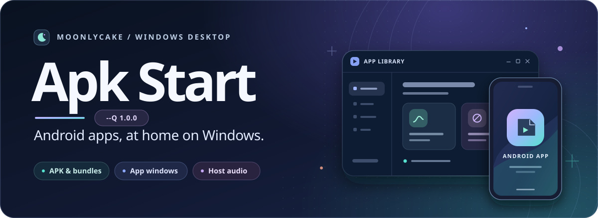
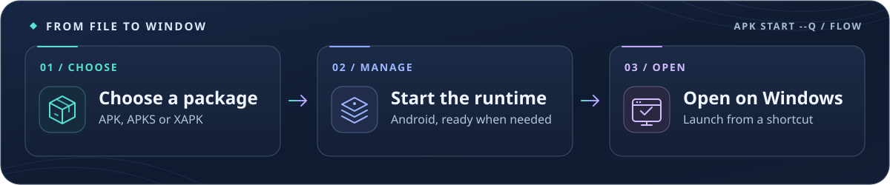
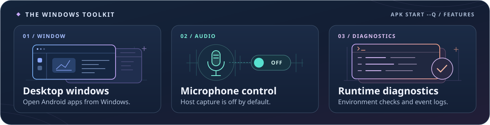

<p align="center">
  
</p>

<h1 align="center">Apk Start --Q 1.0.0</h1>

<p align="center"><strong>让 Android 应用从 Windows 桌面直接打开。</strong></p>
<p align="center">
  <a href="#快速开始">快速开始</a> ·
  <a href="#功能与边界">功能与边界</a> ·
  <a href="#构建和测试">构建和测试</a> ·
  <a href="#反馈与许可">反馈与许可</a>
</p>

**Apk Start --Q** 是一个面向 **Windows 10 / 11 x64** 的 Android 应用运行器。导入安装包后，可以为应用建立桌面与开始菜单入口。程序按需管理 Android 运行时，不必先打开另一款模拟器。

## 快速开始



1. **从源码启动。** 在 Windows 上准备 Git 和 Node.js 20 或更新版本，然后运行：

   ```powershell
   git clone https://github.com/MoonlyCake/apkstart.git
   cd apkstart
   npm ci
   npm start
   ```

2. **准备运行时。** 首次打开时，按程序提示部署 Android Emulator、ADB 和系统镜像。初次部署需要联网下载组件，并为镜像、应用数据和快照留出磁盘空间。
3. **安装并打开。** 从界面选择 `.apk`、`.apks` 或 `.xapk`；也可以先开启 `.apk` 文件关联，再从资源管理器双击安装。安装完成后，可以从应用列表或已创建的快捷方式打开。

## 功能与边界



| 功能 | 使用时要知道 |
| --- | --- |
| **独立窗口与快捷方式** | 支持原生窗口与嵌入窗口，默认使用原生窗口。可在工具栏、托盘或设置里调整显示方式；物理面板换向可能需要重启安卓运行时。 |
| **安装普通与拆分 APK** | `.apks` 和 `.xapk` 中包含的 APK 分片可一并安装。能否运行取决于应用要求的 Android 版本、原生库架构和所用镜像。 |
| **Windows 麦克风与声音输出** | 在「设置 → 性能与资源」显式开启 **Windows 麦克风输入**，重启安卓运行时，并在 Android 中按需授予应用录音权限。输入默认关闭，播放独立走 Windows 输出。这是声音转发，不是 USB 设备直通。 |
| **共享目录与诊断** | Windows 与 Android 之间通过目录同步交换文件；设置页提供诊断报告、运行时日志和残留缓存扫描。 |

普通安装不会替应用批量授权，网络修复也不会自动清除安卓数据。已有用户数据时，不会只因为下载了新镜像就擅自替换原镜像。

<details>
<summary><strong>安装失败、没有硬件加速或找不到日志？</strong></summary>

- **启动慢或提示缺少硬件加速**：先到「设置 → 诊断与修复」运行本机体检，按报告检查 CPU 虚拟化和 Windows 虚拟机监控程序平台。见[环境体检说明](docs/preflight.md)。
- **提示应用需要其他镜像**：先检查 APK 架构和已部署镜像。切换到与现有安卓数据不兼容的镜像前先备份，不要把重置当成普通安装步骤。
- **点击后没有反应**：优先从设置导出诊断报告。普通桌面版默认日志位于 `%APPDATA%\apkstart\logs\app.log`。提交报告前请检查并删去不愿公开的信息。

</details>

## 构建和测试

| 命令 | 用途 |
| --- | --- |
| `npm run pack` | 构建轻量便携版。默认输出 `dist/ApkStart-win64-portable/ApkStart.exe`。 |
| `npm run runtime` → `npm run pack:full` | 先准备运行时组件，再构建包含运行时的完整便携版。 |
| `npm test` | 运行软件回归测试。 |
| `npm run test:ui` | 用 Electron 渲染设置页并执行界面回归。 |

本项目从 **1.0.0** 开始独立编号。内置软件更新只认[本仓库的 GitHub 发行页](https://github.com/MoonlyCake/apkstart/releases)，不跟随上游版本。Android 运行时组件的下载源不变。

想了解实现，可读[架构说明](docs/rewrite-architecture.md)、[工程边界与诊断](docs/rewrite-follow-up.md)和 [Windows 音频说明](docs/rewrite-phase-2.md)。

## 反馈与许可

欢迎在 [Issues](https://github.com/MoonlyCake/apkstart/issues) 反馈。请附上 Windows 版本、复现步骤和必要的诊断摘要。开发约定见 [CONTRIBUTING.md](CONTRIBUTING.md)。

上游为 [RoutineMiku/apkstart](https://github.com/RoutineMiku/apkstart)，本分支遵循 [MIT 许可证](LICENSE)。
