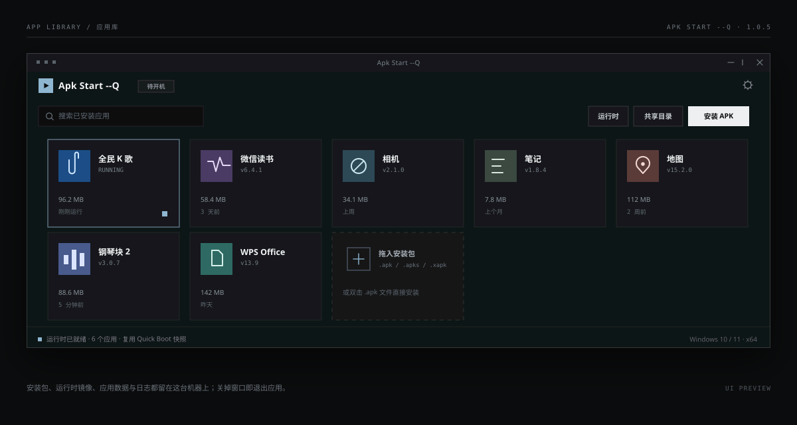
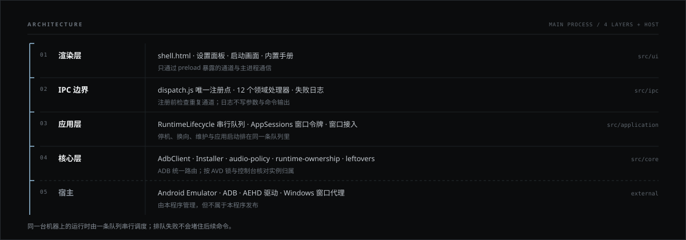

<p align="center">
  
</p>

<h3 align="center">把 APK 变成桌面上可以双击的窗口。</h3>

<p align="center">
  <a href="#三分钟上手">三分钟上手</a> ·
  <a href="#双向音频">双向音频</a> ·
  <a href="#内部结构">内部结构</a> ·
  <a href="#边界">边界</a> ·
  <a href="#构建与测试">构建与测试</a>
</p>

**Apk Start --Q** 是给 Windows 10 / 11 x64 用的 Android 应用运行器。导入安装包，它会按需准备 Android 运行时，并在桌面与开始菜单留下入口；之后双击图标，应用就以自己的窗口打开，不必先启动另一款模拟器管理器。

它不是一个完整的安卓系统：没有应用商店，不替你批量授权，也不会为了「看起来正常」而清空已有的应用数据。



## 三分钟上手


**1 · 从源码启动。** 需要 Git 与 Node.js 20 或更新版本：

```powershell
git clone https://github.com/MoonlyCake/apkstart.git
cd apkstart
npm ci
npm start
```

**2 · 准备运行时。** 首次打开时按提示部署 Android Emulator、ADB 与系统镜像。这一步需要联网，并为镜像、应用数据和快照留出约 3 GB 空间。

**3 · 安装并打开。** 从界面选择 `.apk`、`.apks` 或 `.xapk`；也可以先打开 `.apk` 文件关联，之后从资源管理器双击安装。装完即可从应用列表或已创建的快捷方式启动。

> 启动慢或提示缺少硬件加速时，先到「设置 → 诊断与修复」跑一次本机体检，按报告检查 CPU 虚拟化与 Windows 虚拟机监控程序平台。说明见[环境体检](docs/preflight.md)。

## 双向音频


**你在 Windows 这头说话，安卓应用从那头收声。** 录音走 Windows 默认麦克风，播放回到 Windows 默认输出；两条路各自有开关，不开麦克风也照常能听见声音。

[`audio-policy.js`](src/core/audio-policy.js) 把这两件事分别映射成 AVD 的 `hw.audioInput` 与 `hw.audioOutput`，只有显式开启麦克风时才给 Android Emulator 传 `-allow-host-audio`。音频配置也纳入 Quick Boot 快照的兼容性判断：设置对不上就跳过旧快照，已装的应用与数据保留。

想试录音，按这个顺序走：

1. 在 Windows「设置 → 系统 → 声音」选好默认麦克风与耳机；
2. 在「设置 → 性能与资源」打开 **Windows 麦克风输入**；
3. 重启安卓运行时，再给安卓应用录音权限。

麦克风默认关闭。这是音频转发，不是 USB 设备直通——安卓拿不到耳机或麦克风的 Windows 设备 ID。开关、启动参数与快照策略都已有自动化测试，真实麦克风、耳机与全民 K 歌录音仍待实机验证。详见 [Windows 音频说明](docs/rewrite-phase-2.md)。

## 内部结构



- **运行时串行调度，会话独立管理。** [`RuntimeLifecycle`](src/application/runtime-lifecycle.js) 把启动、停机、换向和维护排进同一条队列，只合并未被停机、换向或维护隔开的同类启动；物理换向须确认停机后才写面板配置。[`AppSessions`](src/application/app-sessions.js) 用窗口令牌隔离旧窗口的迟到回调，避免误关新窗口。
- **ADB 统一路由，按实例核验归属。** [`AdbClient`](src/core/adb.js) 收口 ADB 程序、服务端口与命令传输，区分服务端操作和指定设备的命令；[归属校验](src/core/runtime-ownership.js) 交叉核对 AVD 锁、监听端口所属 PID 与控制台报告的 AVD 名称，不靠端口猜。
- **拆分包流式暂存。** [`parseBundle`](src/core/installer.js) 按 ZIP 条目声明的体积预检磁盘，把 `.apks` / `.xapk` 的分片流式写进独立临时目录，再按实际写入量复查容量；ABI 兼容性重试复用这批分片，结束即清理。
- **IPC 单点注册。** [`dispatch.js`](src/ipc/dispatch.js) 在注册前检查重复通道，处理器按业务拆成 12 个模块，保留原有 preload 通道名与返回结构；[失败日志](src/ipc/failure.js) 只记通道、分类与项目内位置，不写请求参数。
- **残留扫描离开主进程的同步路径。** [`leftovers.js`](src/core/leftovers.js) 异步查注册表、分批并行取文件信息，只读预览与确认后的删除分开，避免磁盘盘点期间主进程干等。

更完整的取舍记录在[架构说明](docs/rewrite-architecture.md)与[工程边界](docs/rewrite-follow-up.md)。

## 边界

| 会做 | 需要知道的 |
| --- | --- |
| **独立窗口与快捷方式** | 原生窗口与嵌入窗口都支持，默认原生。可在工具栏、托盘或设置里改；物理面板换向可能要重启运行时。 |
| **普通与拆分安装包** | `.apks` / `.xapk` 里的分片一并安装。能否运行取决于应用要求的 Android 版本、原生库架构与所用镜像。 |
| **Windows 麦克风与声音输出** | 录音与播放分开控制，开启方法见[双向音频](#双向音频)。 |
| **共享目录与诊断** | 两系统经目录同步交换文件；设置页提供诊断报告、运行时日志与残留缓存扫描。 |

普通安装不会替应用批量授权，网络修复也不会顺手清空安卓数据。已有用户数据时，不会因为下载了新镜像就替换原镜像。

<details>
<summary><strong>安装失败、没有硬件加速、找不到日志？</strong></summary>

- **提示应用需要其他镜像**：先看 APK 架构与已部署镜像是否匹配。切换到与现有数据不兼容的镜像前先备份——重置不是普通安装步骤。
- **adb 未授权**：在安卓的开发者选项里允许 USB 调试；程序只使用本机配置的端口，不会清掉别的模拟器。
- **点图标没反应**：优先从设置导出诊断报告。默认日志在 `%APPDATA%\apkstart\logs\app.log`。提交前请自行检查并删去不愿公开的内容。

常见报错的逐条处理见[用户手册](docs/USER-MANUAL.md)。

</details>

## 构建与测试

| 命令 | 用途 |
| --- | --- |
| `npm run pack` | 构建轻量便携版，输出 `dist/ApkStart-win64-portable/ApkStart.exe`。 |
| `npm run runtime` → `npm run pack:full` | 先准备运行时组件，再构建带运行时的完整便携版。 |
| `npm test` | 软件回归测试（含 `test:rewrite`）。 |
| `npm run test:ui` | 用 Electron 渲染设置页并跑界面回归。 |

本项目从 **1.0.0** 起独立编号。内置的软件更新只认[本仓库的 GitHub 发行页](https://github.com/MoonlyCake/apkstart/releases)，不跟随上游版本；Android 运行时组件的下载源不变。

## 反馈与许可

欢迎在 [Issues](https://github.com/MoonlyCake/apkstart/issues) 反馈，附上 Windows 版本、复现步骤与必要的诊断摘要。开发约定见 [CONTRIBUTING.md](CONTRIBUTING.md)。

上游为 [RoutineMiku/apkstart](https://github.com/RoutineMiku/apkstart)，本分支遵循 [MIT 许可证](LICENSE)。
